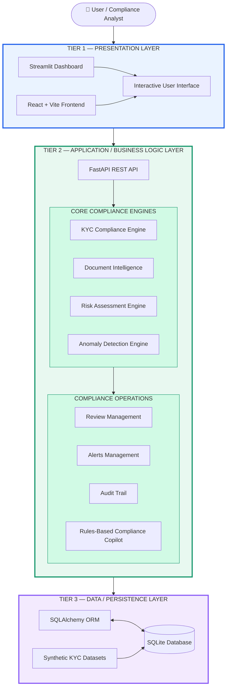

# 🛡️ KYC Compliance AI System

### Intelligent KYC Compliance Monitoring & Risk Intelligence Platform

A full-stack KYC compliance monitoring platform designed to manage customer onboarding evidence, validate document completeness, monitor compliance risks, investigate anomalies, manage periodic reviews, and maintain auditable compliance records through an integrated intelligence dashboard.

---

## 🚀 Live Application

- **Frontend Dashboard:** [Open Live Application](https://kyc-compliance-ai-system-nzbu8mlzt2necak4u5j2xq.streamlit.app/)
- **Backend API:** [KYC Compliance API](https://kyc-compliance-ai-system.onrender.com)
- **GitHub Repository:** [View Source Code](https://github.com/RAJESHPAGIDIPALLI383/kyc-compliance-ai-system)

---

# 🏗️ SYSTEM ARCHITECTURE — 3-TIER ARCHITECTURE

The application follows a three-tier architecture that separates the presentation layer, application/business logic layer, and data persistence layer.

This separation improves modularity, maintainability, and organization of the application's components.



### Tier 1 — Presentation Layer

Responsible for user interaction, dashboards, visualizations, and presentation of compliance information.

- Streamlit Dashboard
- React and Vite Frontend
- Interactive charts and metrics
- Customer and document interfaces
- Risk and compliance views

### Tier 2 — Application Layer

Responsible for processing business rules, compliance operations, risk analysis, and application services.

- FastAPI REST API
- KYC Compliance Engine
- Document Intelligence Engine
- Risk Assessment Engine
- Anomaly Detection Engine
- Review Management
- Alerts Management
- Audit Trail
- Rules-Based Compliance Copilot

### Tier 3 — Data Layer

Responsible for structured data storage, database operations, and persistence.

- SQLite Database
- SQLAlchemy ORM
- Customer records
- Document records
- Risk and review records
- Alerts and audit events
- Synthetic KYC datasets

---

## 📌 Project Overview

Financial institutions need to continuously monitor customer identity information, onboarding documents, compliance requirements, and changing risk indicators.

The KYC Compliance AI System provides a centralized platform to demonstrate these activities through an integrated dashboard and compliance intelligence services.

### Key Capabilities

- Customer onboarding evidence monitoring.
- Document completeness and expiry tracking.
- Customer risk assessment.
- Anomaly identification and investigation.
- Periodic KYC review management.
- Compliance alert monitoring.
- Audit history and traceability.
- Rules-based compliance assistance.

---

# 🧩 APPLICATION MODULES

| No. | Module | Functionality |
|---|---|---|
| 01 | Executive Dashboard | Overall compliance metrics and operational overview |
| 02 | Customer 360 | Consolidated customer profile and KYC information |
| 03 | Document Intelligence | Document completeness, validation and expiry monitoring |
| 04 | Risk Intelligence | Customer risk assessment and risk indicators |
| 05 | Anomaly Investigation | Investigation of unusual records and exceptions |
| 06 | Review Management | Periodic KYC review and case tracking |
| 07 | Alerts Center | Centralized compliance alert monitoring |
| 08 | Audit Trail | Activity history and traceability |
| 09 | AI Compliance Copilot | Rules-based compliance insights and assistance |

---

# 🖥️ APPLICATION SCREENSHOTS

The following screenshots show the actual application modules.

### 01. Executive Dashboard


### 02. Customer 360


### 03. Document Intelligence


### 04. Risk Intelligence


### 05. Anomaly Investigation


### 06. Review Management


### 07. Alerts Center


### 08. Audit Trail


### 09. AI Compliance Copilot


---

# 🛠️ TECHNOLOGY STACK

| Category | Technologies |
|---|---|
| Programming Language | Python |
| Backend Framework | FastAPI |
| Dashboard Framework | Streamlit |
| Frontend | React, Vite |
| Database | SQLite |
| ORM | SQLAlchemy |
| Data Processing | Pandas, NumPy |
| Data Visualization | Plotly |
| Testing | Pytest |
| Version Control | Git, GitHub |
| Deployment | Streamlit Community Cloud, Render |

---

# 📊 DATASET OVERVIEW

The project uses generated synthetic KYC datasets for demonstration, validation, and analysis.

| Dataset | Records |
|---|---:|
| Customers | 8,000 |
| Documents | 25,200 |
| Risk Ratings | 8,000 |
| Review Cases | 3,000 |
| Alerts | 22,570 |
| Audit Events | 93,939 |

*These figures represent generated demonstration data, not real banking customer records.*

---

# 📁 PROJECT STRUCTURE

```text
kyc-compliance-ai-system/
│
├── frontend/                 # React and Vite frontend
├── generator/                # Synthetic data generation
├── src/                      # Application and compliance logic
├── database/                 # Database-related resources
├── data/                     # Generated datasets
├── docs/
│   └── screenshots/          # Nine application screenshots
│
├── tests/                    # Testing resources
├── reports/                  # Generated reports
├── streamlit_app.py          # Streamlit dashboard entry point
├── requirements.txt          # Python dependencies
└── README.md                 # Project documentation
```

---

# ⚙️ LOCAL INSTALLATION & SETUP

### Prerequisites

- Python 3.10 or later
- Git
- pip

### 1. Clone the Repository

```bash
git clone https://github.com/RAJESHPAGIDIPALLI383/kyc-compliance-ai-system.git
cd kyc-compliance-ai-system
```

### 2. Create a Virtual Environment

```bash
python -m venv .venv
```

### 3. Activate the Environment

Windows PowerShell:

```powershell
.\.venv\Scripts\Activate.ps1
```

### 4. Install Dependencies

```bash
python -m pip install -r requirements.txt
```

### 5. Run the Dashboard

```bash
streamlit run streamlit_app.py
```

Open the application:

http://localhost:8501

---

# 🌐 DEPLOYMENT & ACCESS

| Service | URL |
|---|---|
| Live Dashboard | https://kyc-compliance-ai-system-nzbu8mlzt2necak4u5j2xq.streamlit.app/ |
| Backend API | https://kyc-compliance-ai-system.onrender.com |
| GitHub Repository | https://github.com/RAJESHPAGIDIPALLI383/kyc-compliance-ai-system |

---

# 🔐 SECURITY & DATA DISCLAIMER

- The project uses synthetic demonstration data.
- It is not connected to real banking customer records.
- The application is a portfolio demonstration and is not a certified production banking compliance solution.
- The Compliance Copilot uses rules-based logic; it does not replace professional compliance decisions.
- Do not upload confidential or personally identifiable customer information.

---

# 🎯 PROJECT OBJECTIVES

- Demonstrate a structured three-tier software architecture.
- Integrate customer and document compliance monitoring.
- Implement risk intelligence and anomaly investigation workflows.
- Demonstrate periodic review and alert management.
- Maintain traceable audit records.
- Present compliance insights through interactive dashboards.

---

# 👨‍💻 DEVELOPER

**Rajesh Pagidipalli**

B.Tech — Information Technology

- GitHub Profile: [RAJESHPAGIDIPALLI383](https://github.com/RAJESHPAGIDIPALLI383)
- Project Repository: [KYC Compliance AI System](https://github.com/RAJESHPAGIDIPALLI383/kyc-compliance-ai-system)

---

<p align="center">
  <b>Built with Python, Data Intelligence and Compliance Automation.</b>
  <br/>
  ⭐ If you find this project interesting, consider giving the repository a star!
</p>
